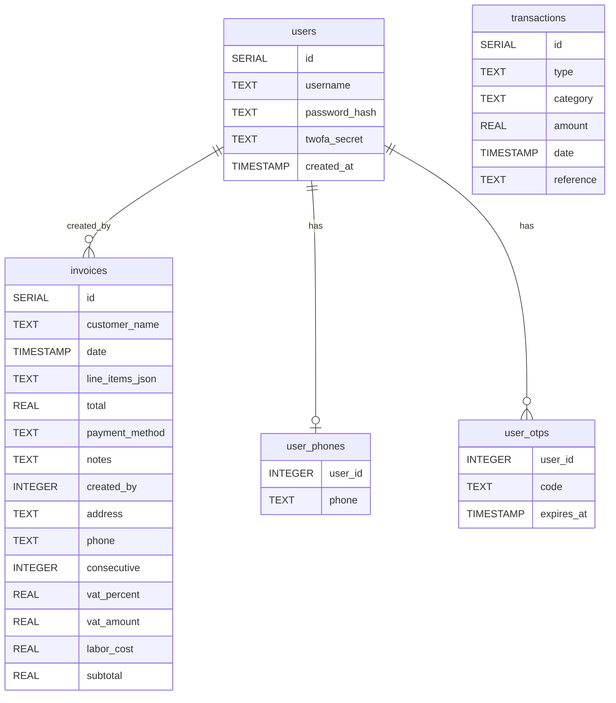

<div style="display:flex;flex-direction:column;gap:8px;align-items:center;margin:16px 0;">
  <div style="width:100%;max-width:920px;background:linear-gradient(135deg,#00ffc6 0%,#5a00ff 60%,#ff3cac 100%);border-radius:14px;padding:20px;color:#0b0b0b;font-weight:700;text-align:center;">
    <div style="font-size:22px;line-height:1.3;">ServSoftBagm — Soluciones de software e informática</div>
    <div style="font-size:13px;margin-top:6px;">Desarrollo a medida · Integración · Automatización · Soporte · Mantenimiento · Recuperación de datos</div>
  </div>
  <div style="display:flex;flex-wrap:wrap;gap:8px;justify-content:center;">
    <a href="https://nodejs.org/" target="_blank" rel="noreferrer"></a>
    <a href="https://react.dev/" target="_blank" rel="noreferrer"></a>
    <a href="https://vitejs.dev/" target="_blank" rel="noreferrer"></a>
    <a href="https://tailwindcss.com/" target="_blank" rel="noreferrer"></a>
    <a href="https://expressjs.com/" target="_blank" rel="noreferrer"></a>
    <a href="https://www.postgresql.org/" target="_blank" rel="noreferrer"></a>
    <a href="https://docs.docker.com/compose/" target="_blank" rel="noreferrer"></a>
  </div>
</div>

# ServSoftBagm — Software, soporte e informática

Aplicación web full‑stack para ofrecer servicios de desarrollo de software, soporte técnico, mantenimiento de equipos y recuperación de información. Conserva el estilo futurista con neon y tarjetas flotantes, e integra:

- Landing informativa con servicios de TI y casos de uso.
- Acceso de administrador con registro y 2FA (TOTP).
- Gestión de facturas y contabilidad básica (ingresos, gastos, activos y pasivos).
- Backend Express + SQLite/PG (conmutables por entorno).
- Frontend React + Vite + Tailwind.
- Integración inicial de WhatsApp: botón flotante y webhook básico de chatbot.


## Requisitos

- Node.js 20.x. Backend con Better‑SQLite3 y Express 5, frontend con React 19 + Vite 7 + Tailwind 4.

## Puesta en marcha (local)

1. Backend:
   - `cd server`
   - Copia `.env.example` a `.env` y ajusta `JWT_SECRET`.
   - Para SQLite local: dejar `DB_DRIVER` vacío.
   - Para PostgreSQL: definir `DB_DRIVER=pg` y `DATABASE_URL`.
   - `npm run dev`
   - API en `http://localhost:3001/`.
   - Webhook de WhatsApp: `GET/POST http://localhost:3001/webhooks/whatsapp` (requiere exposición pública para Meta).
   - Autenticación por teléfono (OTP):
     - `POST /api/auth/register-phone` (username, password, phone)
     - `POST /api/auth/request-otp` (phone)
     - `POST /api/auth/login-phone` (phone, code)

2. Frontend:
   - `cd client`
   - `npm run dev`
   - Abre `http://localhost:5173/` (si el puerto está ocupado, Vite usa otro).
   - Botón de WhatsApp y sección de ayuda al final del Dashboard. Ajusta el número en `client/src/config.js` (CONTACT_WHATSAPP).

## Flujo de autenticación 2FA

1. Registra el usuario en `/register`.
2. Configura 2FA en `/setup-2fa` y escanea el QR con Google Authenticator/Authy.
3. Inicia sesión en `/login` con usuario, contraseña y código 2FA.

## Facturación y contabilidad

- En el dashboard:
  - Crear facturas con ítems, método de pago y notas.
  - Ver listado de facturas y totales.
  - Añadir transacciones manuales (income/expense/asset/liability).
  - Ver resumen: ingresos, gastos, activos, pasivos y utilidad.

## Estructura

- `apps/server/` → Backend (Express + PostgreSQL/SQLite) — ahora parte del monorepo.
- `apps/client/` → Frontend (React + Vite + Tailwind) — ahora parte del monorepo.
- Estructura profesional con Turborepo + npm workspaces.
  - `LoginPhone.jsx`: Acceso por teléfono (OTP) y solicitud de código.

### Estructura del repositorio

```text
ServSoftBagm/ (Monorepo con Turborepo)
├─ apps/
│  ├─ client/           # Frontend React + Vite + Tailwind
│  └─ server/           # Backend Express + PostgreSQL/SQLite
│     ├─ routes/
│     ├─ services/      # Lógica de negocio (Analytics, IA Engine, etc.)
│     └─ db-pg.js / db-sqlite.js
├─ packages/            # Código compartido (futuro)
├─ scripts/             # Scripts de desarrollo y setup
├─ docker-compose.yml   # PostgreSQL (principalmente)
├─ README.md            # Guía principal
└─ MASTERDOC.md         # Documento de análisis y ruta técnica
```

## Documentación

Toda la documentación del proyecto está organizada en la carpeta `/docs`.

**Índice principal**: **[docs/INDEX.md](./docs/INDEX.md)**

### Documentación Técnica

- [Diagrama Entidad-Relación (Base de Datos)](./docs/database/ENTITY_RELATIONSHIP_DIAGRAM.md)
- [Diagrama de Clases](./docs/architecture/CLASS_DIAGRAM.md)
- [Diagrama de Despliegue](./docs/deployment/DEPLOYMENT_DIAGRAM.md)
- [Visión General de Arquitectura](./docs/architecture/ARCHITECTURE_OVERVIEW.md)
- [Proceso: Intake de Cliente](docs/guides/PROCESS_CLIENT_INTAKE.md)

### Guías y Procesos

- [Portal del Cliente y 2FA](./CLIENT_PORTAL_AND_2FA_GUIDE.md)
- [Plan de Automatización y Migración](./AUTOMATION_AND_MIGRATION_PLAN.md)
- [Roadmap de Producción](./PRODUCTION_ROADMAP.md)

**Nota importante:** Los documentos antiguos que estaban en la raíz del proyecto se conservan como referencia histórica. La documentación activa y actualizada se encuentra dentro de `/docs`.

---

## Despliegue Rápido en Render.com

**Guía completa y actualizada**: Ver el archivo **[DEPLOY_RENDER.md](./DEPLOY_RENDER.md)**

Contiene instrucciones detalladas paso a paso usando Blueprint + cómo configurar correctamente `VITE_API_URL` y `VITE_OPEN_ACCESS`.

## Despliegue y GitHub (resumen rápido)

- Inicializa git en el root:
  - `git init`
  - `git add .`
- `git commit -m "ServSoftBagm: primera versión"`
  - `git branch -M main`
- `git remote add origin https://github.com/IRTELC01/ServSoftBagm.git`
  - `git push -u origin main`

Si necesitas pipeline de despliegue o empaquetado, se recomienda Dockerizar en una siguiente etapa.

## Integración WhatsApp (Chatbot básico)

- Requisitos en `apps/server/.env` (ver ejemplo en `.env.example`):
  - `WHATSAPP_TOKEN`: token de acceso de Meta (WhatsApp Cloud API).
  - `WHATSAPP_PHONE_NUMBER_ID`: ID del número de WhatsApp Business.
  - `WHATSAPP_VERIFY_TOKEN`: cadena propia para verificar el webhook.

- Pasos:
  1. Crear App en Facebook Developers y habilitar WhatsApp Cloud.
  2. Obtener `WHATSAPP_TOKEN` y `WHATSAPP_PHONE_NUMBER_ID`.
  3. Configurar `WHATSAPP_VERIFY_TOKEN` tanto en `.env` como en el panel de Meta.
  4. Exponer públicamente `GET/POST /webhooks/whatsapp` (ngrok o similar) y registrar el endpoint en Meta.
5. Probar enviando mensajes al número: el bot contesta a “hola”, “soporte”, “mantenimiento”, “desarrollo”.

- Botón de WhatsApp en el frontend:
  - Edita `apps/client/src/config.js` y define `CONTACT_WHATSAPP` con tu número en formato internacional (ej. 573127818103).
  - Puedes prellenar mensajes: `https://wa.me/573127818103?text=Hola%20quiero%20cotizar`.
  - En el Dashboard encontrarás un panel de ayuda y un botón para contactar por WhatsApp.

## Base de datos y ERD

- Driver conmutable: `DB_DRIVER` (`''` para SQLite, `pg` para PostgreSQL).
- En PostgreSQL se crean tablas equivalentes a SQLite con campos extra de facturación.

---

## 🚀 DESPLIEGUE RÁPIDO (Render / Railway) — 5 minutos

### Opción recomendada: **Render** (gratis)

1. Haz fork o push de este repo.
2. En [render.com](https://render.com) → **New +** → **Blueprint** y selecciona `render.yaml` (o crea los dos servicios manualmente).
3. **Primer deploy del API**:
   - Espera a que el servicio `servsoftbagm-api` esté vivo.
   - Copia su URL pública (ej: `https://servsoftbagm-api.onrender.com`).
4. **Frontend estático**:
   - Edita la variable `VITE_API_URL` en el servicio web estático y pon:  
     `https://servsoftbagm-api.onrender.com/api`
   - Añade también `VITE_OPEN_ACCESS=true` (para demo sin login).
5. Redeploy el frontend.
6. ¡Listo! Accede a `https://tu-frontend.onrender.com` y prueba el Dashboard con credenciales por defecto (`admin` / `servsoft123`).

**Para producción real**:
- Cambia `DEFAULT_ADMIN_PASSWORD` y `JWT_SECRET`.
- Pon `OPEN_ACCESS=false` y `VITE_OPEN_ACCESS=false`.
- Activa 2FA desde el panel de login.

### Railway (alternativa más fácil para fullstack)

```bash
# En Railway
railway init
railway up
# Configura las mismas variables de entorno que en render.yaml
```

### Probar localmente (desarrollo ultra-rápido)

```powershell
# Terminal 1 - Backend
cd server
npm install
npm start

# Terminal 2 - Frontend
cd client
npm install
npm run dev
```

Abre http://localhost:5173 → Login → Dashboard.

**Credenciales por defecto**: `admin` / `servsoft123`

El Dashboard ahora tiene:
- KPIs grandes con glow neón
- Gráficos donut + barras animadas
- Formulario premium de facturación
- Búsqueda y export CSV de facturas
- Diseño futurista dark + glassmorphism

Listo para impresionar en demo o cliente.


## Orquestación con Docker

- Requiere Docker y Docker Compose.
- En el root:
  - `docker compose up`
- Servicios:
  - Base de datos Postgres (puerto 5432)
  - Backend en `http://localhost:3001` (usa `DB_DRIVER=pg` y `DATABASE_URL`)
  - Frontend en `http://localhost:5173`
  - Variables clave ya definidas en `docker-compose.yml`.

 - Contraseña admin por defecto: `servsoft123` (puede cambiarse con `DEFAULT_ADMIN_PASSWORD`).
 - Para reiniciar la contraseña del admin en cada arranque define `RESET_ADMIN_PASSWORD_ON_START=true` en el backend.
## Arranque rápido (automatizado)

- Local en un solo comando:
  - Primero asegúrate de tener Node 20.19.0: `powershell -ExecutionPolicy Bypass -File .\scripts\install-node.ps1`
  - `powershell -ExecutionPolicy Bypass -File .\scripts\dev-all.ps1 -Disable2FA`
  - Hace todo: prepara `apps/server/.env` y datos, arranca backend, verifica salud, resetea admin, arranca frontend y abre `/login`.
  - Credenciales por defecto (Docker): `admin / servsoft123`.
## Notas

- El backend soporta `DATA_DIR` para ubicar la base de datos y archivos locales (SQLite).
- En producción se recomienda PostgreSQL.
## Instalación local de datos


- Soporte de `DATA_DIR` en backend para ubicar la base de datos y archivos en directorio local preferido.
- En Windows, se sugiere: `C:\Users\TU_USUARIO\Documents\ServSoftBagm`.
- Configura `DATA_DIR` en `apps/server/.env` (copiar desde `.env.example`).
- Opcional: usaremos un script PowerShell `scripts/setup-local.ps1` para crear carpetas y configurar `.env` automáticamente.
- Opcional: usaremos un script PowerShell `scripts/setup-local.ps1` para crear carpetas y configurar `.env` automáticamente.

## Contacto y crédito

- WhatsApp: `+57 312 781 8103`
- Ubicación: Medellín, Colombia 
- Marca: ServSoftBagm
