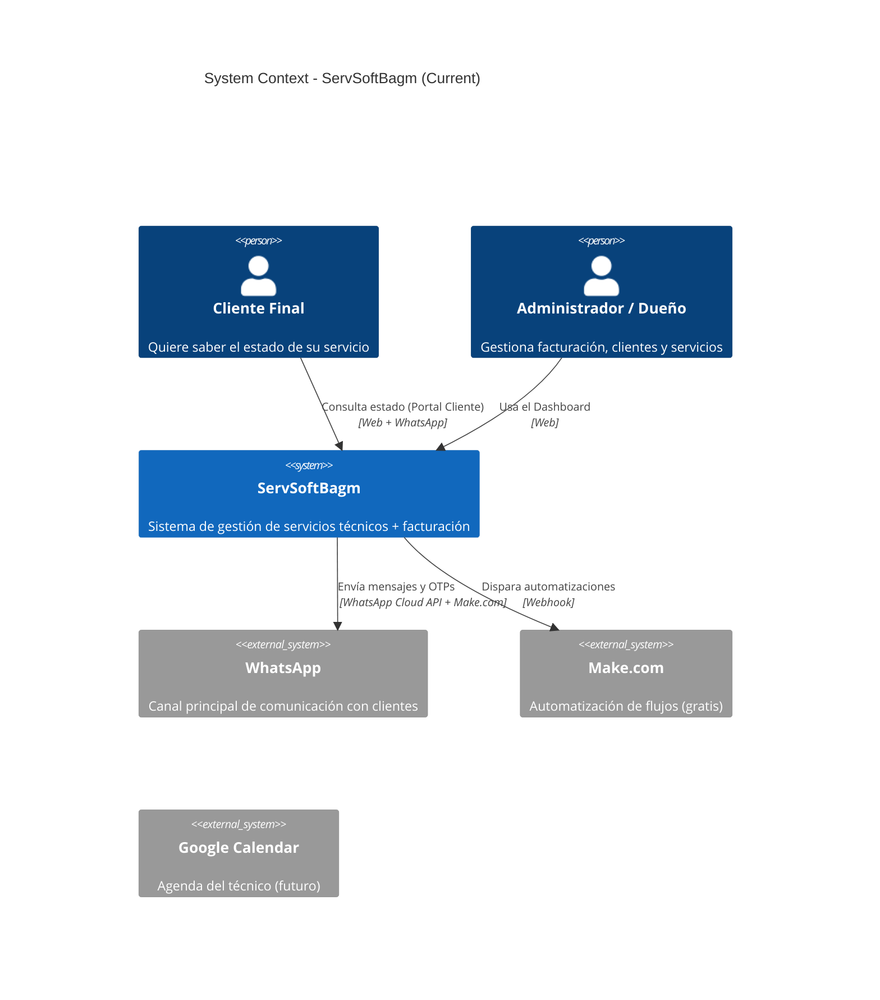

# Architecture Overview

**Project:** ServSoftBagm  
**Current Phase:** Validation (Zero Budget)  
**Last Updated:** 2026-05-30

---

## Current Architecture (Validation Phase)

---

## Current Technology Stack

| Layer          | Technology                          | Notes |
|----------------|-------------------------------------|-------|
| Frontend       | React 19 + Vite + Tailwind          | Diseño futurista/neón |
| Backend        | Node.js + Express 5                 | Monolito |
| Database       | SQLite (principalmente)             | Fácil para desarrollo local |
| Authentication | JWT + TOTP (2FA)                    | speakeasy |
| Client Portal  | React (ruta `/cliente`)             | Login ligero con Ticket + OTP |
| Automation     | Make.com (free tier)                | Orquestación de WhatsApp |
| Hosting        | Render (Free Tier)                  | Con limitaciones conocidas |

---

## Target Architecture (Cuando haya presupuesto)

- Backend: Node.js con **Clean Architecture** (o Hexagonal)
- Base de datos: PostgreSQL
- Automatización: **n8n** self-hosted + Evolution API
- Mensajería: BullMQ o RabbitMQ (para tareas en background)
- Autenticación: JWT + Roles + 2FA
- Despliegue: Contenedores (Docker) + mejor orquestación

---

## Principios Arquitectónicos Actuales

- **Pragmatismo primero**: Preferimos soluciones simples que funcionen rápido mientras validamos el negocio.
- **Separación de responsabilidades** (en progreso): Intentamos no mezclar lógica de negocio con controladores.
- **Datos estructurados**: Todo lo que sale del Chatbot va estructurado (pensando en Make.com y futuras integraciones).
- **Cero costo durante validación**: Toda la automatización se hace dentro de límites gratuitos.

---

## Decisiones Técnicas Importantes

| Decisión | Razón | Riesgo |
|----------|-------|--------|
| Usar SQLite en desarrollo | Fácil de resetear, sin depender de Docker/Postgres siempre | Migración posterior |
| Usar Make.com para automatización | Rápido de implementar y gratis | Vendor lock-in |
| Login del cliente sin contraseña | Reduce fricción | Menor seguridad (mitigado con OTP + Ticket) |
| 2FA solo para administradores | Costo de fricción vs seguridad | Clientes no tienen 2FA fuerte |

---

**Este documento debe actualizarse cuando cambie la arquitectura principal del sistema.**