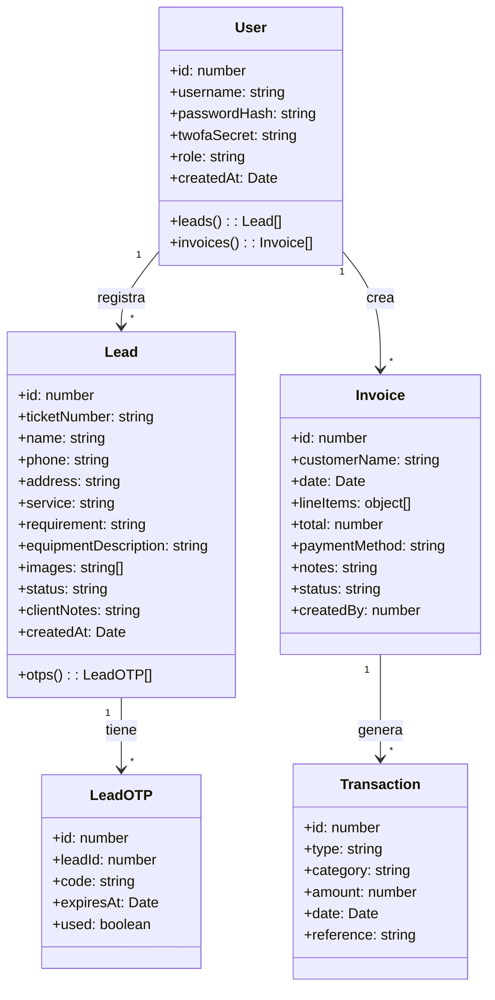

# Diagrama de Clases (Simplificado)

**Proyecto:** ServSoftBagm  
**Fecha:** 2026-05-30  
**Nivel:** Conceptual / Alto Nivel

---

## Diagrama

---

## Explicación de las Entidades Principales

### User
- Representa tanto administradores como (en el futuro) clientes.
- Actualmente solo existe el rol `admin` / `superadmin`.

### Lead
- Es la entidad central del sistema en esta fase.
- Representa una solicitud de servicio (puede provenir del chatbot o registro manual).
- Contiene toda la información necesaria para dar seguimiento (incluyendo fotos del equipo).

### LeadOTP
- Códigos de un solo uso para que el cliente acceda al Portal sin contraseña.

### Invoice & Transaction
- Módulo actual de facturación y contabilidad básica.

---

## Notas

- Este diagrama es **simplificado** y representa el estado actual del sistema.
- En fases futuras se recomienda separar `Client` de `Lead` y crear una entidad `Equipment`.
- El modelo actual prioriza velocidad de desarrollo sobre normalización perfecta.

**Recomendación:** Mantener este diagrama actualizado cada vez que se agregue una entidad importante al sistema.
