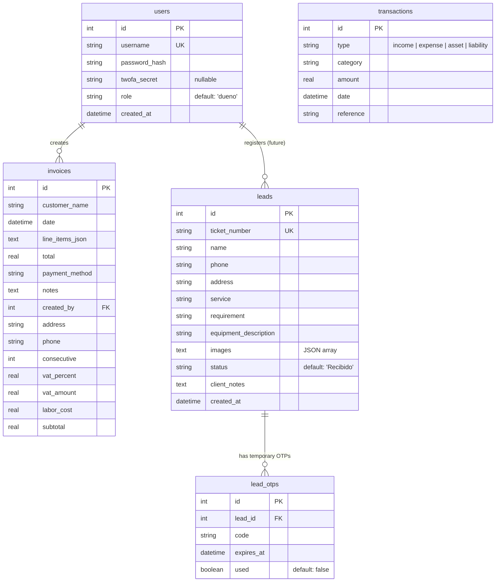

# Entity Relationship Diagram (ERD)

**Project:** ServSoftBagm  
**Last Updated:** 2026-05-30  
**Database:** Currently SQLite (with planned migration to PostgreSQL)

---

## Current Logical Model

---

## Table Descriptions

### users
- Main authentication table.
- Currently only has `admin` user.
- `role` column added for future multi-role support (`superadmin`, `dueno`, `cliente`).

### leads
- Core table for client service requests (from chatbot or manual registration).
- `ticket_number`: Unique identifier the client uses to access the portal.
- `images`: Stored as JSON array of filenames (e.g. `["Imagen5.png", "diagnostico.jpg"]`).
- Used by both the public Client Portal and internal Dashboard.

### lead_otps
- Temporary table for one-time passwords sent to clients.
- Used for passwordless access to the Client Portal.

### invoices & transactions
- Current invoicing and basic accounting module.

---

## Notes & Future Considerations

- The current design is **simple and pragmatic** for the validation phase.
- When migrating to PostgreSQL, most tables can be migrated with minimal changes.
- Future expansions should consider:
  - Separate `clients` table (decoupled from `leads`)
  - `equipment` table (one client can have multiple devices)
  - `service_history` table with foreign keys to `leads` and `users`

**Recommendation:** Do not over-normalize yet. Keep the current `leads` table as the central entity during the MVP/validation phase.
