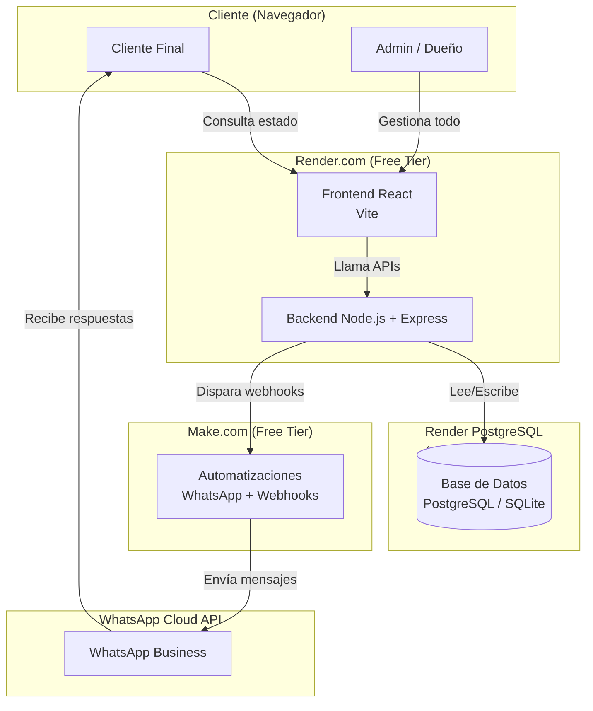
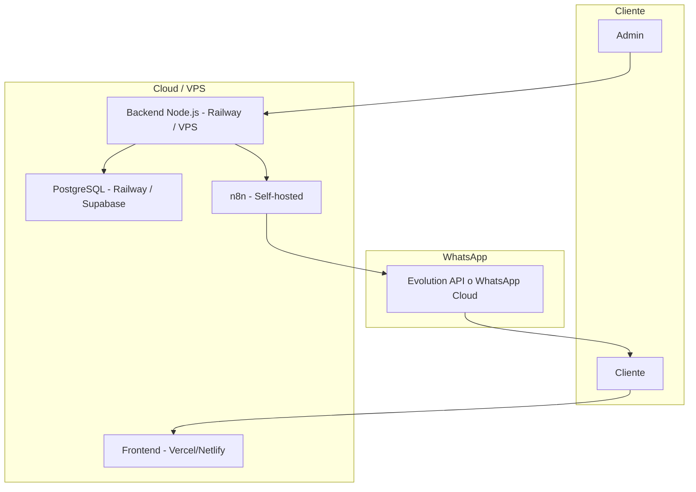

# Deployment Diagram

**Proyecto:** ServSoftBagm  
**Fecha:** 2026-05-30

---

## Arquitectura de Despliegue Actual (Fase de Validación)

---

## Componentes

| Componente          | Dónde está                  | Notas |
|---------------------|-----------------------------|-------|
| Frontend React      | Render (Static Site)        | Sirve la SPA |
| Backend Node.js     | Render (Web Service)        | API principal |
| Base de datos       | PostgreSQL (Render o Docker local) | Actualmente SQLite en local |
| Automatización      | Make.com                    | Gratuito hasta 1000 operaciones |
| Comunicación        | WhatsApp Cloud API          | Gratuito hasta 1000 conversaciones |

---

## Limitaciones Actuales del Despliegue

- Render Free Tier duerme los servicios después de 15 minutos de inactividad.
- No hay workers persistentes fácilmente.
- Make.com tiene límite de operaciones.
- No hay colas de mensajes reales.

---

## Arquitectura de Despliegue Objetivo (Cuando haya presupuesto)

---

**Este documento debe actualizarse cada vez que cambie la infraestructura de despliegue.**
