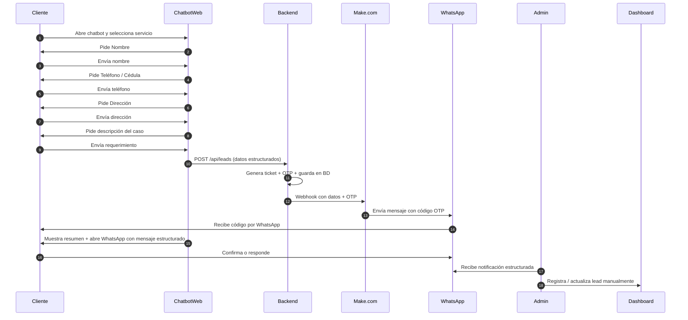

# Proceso: Intake de Cliente (Chatbot → WhatsApp)

**Proyecto:** ServSoftBagm  
**Fecha:** 2026-05-30

---

## Diagrama de Flujo (Swimlane)

---

## Descripción del Proceso

1. El cliente interactúa con el Chatbot web.
2. Se recolectan datos de forma guiada y validada.
3. El backend genera un **ticket** y un **OTP**.
4. El OTP se envía por WhatsApp (a través de Make.com).
5. El cliente recibe un mensaje estructurado por WhatsApp con toda su información.
6. El administrador recibe la notificación y puede registrar el lead en el sistema.

---

## Notas de Implementación

- Todo el flujo está diseñado para ser **100% gratis** durante la fase de validación.
- El backend no envía WhatsApp directamente (para mantenerlo simple y barato). Usa Make.com como capa de mensajería.

**Recomendación:** Mantener este diagrama actualizado cada vez que cambie el flujo de intake del cliente.
